  

### `whoami`

I'm Milan, a passionate developer with a keen interest in Smart Home technologies, particularly in Home Assistant and Node-RED.

#### `stack`

- 🏡 Smart Home: Home Assistant, Node-RED, ESPHome, Tasmota, MQTT, Matter
- 📹 Security Cameras: Frigate NVR, Scrypted
- 📡 Protocols: WiFi, BLE, Zigbee, Z-Wave, Thread, LoRaWAN

#### `projects`

- 📂 [Home Assistant Configuration](https://github.com/milandzuris/homeassistant-config): My Home Assistant configuration.
- 🏡 [Dzuriš Home](https://github.com/DzurisHome): My personal Smart Home project.
- 🏠 [TuYa Data Points](https://github.com/DzurisHome/Tuya-Data-Points): TuYa Data Points for configuration.
- 🌡️ [ESPHome IKEA VINDRIKTNING](https://github.com/DzurisHome/ESPHome-IKEA-VINDRIKTNING): How to make IKEA VINDRIKTNING Smart.

#### `contact`

- 👉 Visit [Linktr.ee/DzurisHome](https://linktr.ee/DzurisHome) for more links and connections!

 

### `stats`

  

