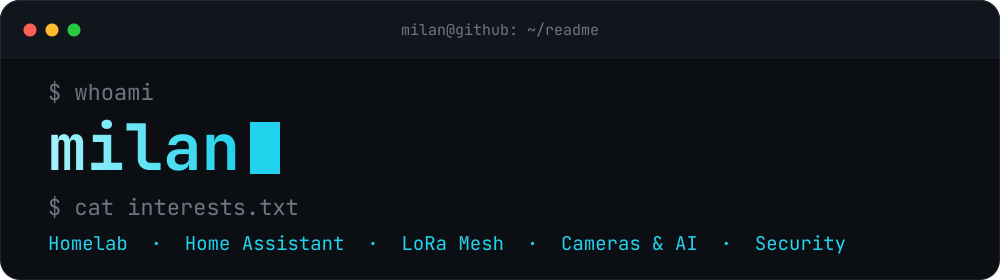
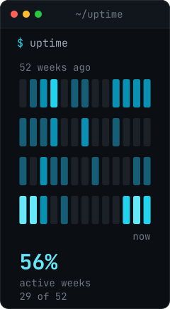
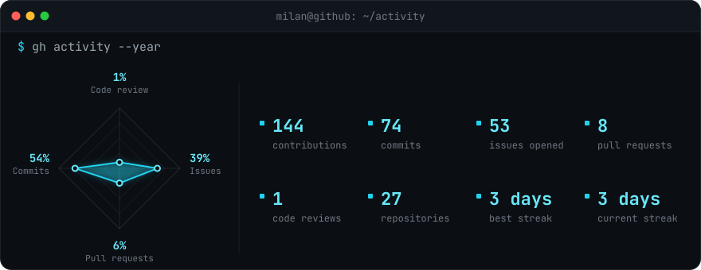

<!-- Na Mobile (užšie ako 768 px) sa obrázky prepnú na mobilné verzie cez <picture> -->

  <picture>
    <source media="(max-width: 767px)" srcset="https://raw.githubusercontent.com/milandzuris/milandzuris/main/images/header-mobile.svg" />
    
  </picture>

### `whoami`

I'm Milan. I build things that run at home and stay at home: a self-hosted smart home, cameras with local AI, mesh radios and a homelab that keeps it all running. Self-sufficient IT, no cloud required.

On the side I dig into OSINT, security research and how AI is changing geopolitics.

<picture>
  <source media="(max-width: 767px)" srcset="https://raw.githubusercontent.com/milandzuris/milandzuris/main/images/blank.svg" />
  
</picture>

#### `stack`

- **Smart Home** — Home Assistant, Node-RED, ESPHome, MQTT
- **Wireless** — Zigbee, Z-Wave, Thread, BLE
- **Radio** — MeshCore, Meshtastic, ADS-B, RTL-SDR
- **Cameras** — Frigate NVR, UniFi, go2rtc, Reolink
- **Vision AI** — Object Detection: people, animals, vehicles, etc.
- **AI** — LLMs, local AI Server
- **Homelab** — Proxmox, LXC, Pi-hole, Uptime Kuma
- **Network** — UniFi, VLANs, VPN, Cloudflare
- **Security** — OSINT, Security Research, Geopolitics & Military, AI-assisted Analysis

#### `projects`

- **[Home Assistant Configuration](https://github.com/milandzuris/homeassistant-config)** — My Home Assistant configuration
- **[Dzuriš Home](https://github.com/DzurisHome)** — My personal Smart Home project
- **[TuYa Data Points](https://github.com/DzurisHome/Tuya-Data-Points)** — TuYa Data Points for configuration
- **[ESPHome IKEA VINDRIKTNING](https://github.com/DzurisHome/ESPHome-IKEA-VINDRIKTNING)** — How to make IKEA VINDRIKTNING Smart

#### `contact`

- Visit [Linktr.ee/DzurisHome](https://linktr.ee/DzurisHome) for more links and connections!

 

  <picture>
    <source media="(max-width: 767px)" srcset="https://raw.githubusercontent.com/milandzuris/milandzuris/main/assets/uptime-mobile.svg" />
    
  </picture>

### `stats`

  <picture>
    <source media="(max-width: 767px)" srcset="https://raw.githubusercontent.com/milandzuris/milandzuris/main/assets/activity-mobile.svg" />
    
  </picture>

### `snake`

  

